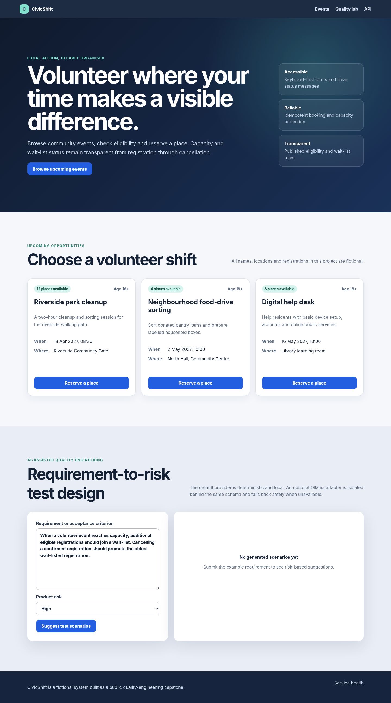

# CivicShift Quality Engineering Capstone

A practical end-to-end quality engineering portfolio built around **CivicShift**, a fictional volunteer-event booking service. The product is intentionally small enough to understand in one review, but its business rules are rich enough to exercise real testing: capacity, eligibility, wait-listing, cancellation promotion, duplicate prevention, idempotent retries, personal-data handling and an AI-assisted test-design endpoint.



This repository is not a folder of disconnected tool samples. It shows how I would approach a release as a senior tester who can work across requirements, risk, manual exploration, automation, APIs, data, security, accessibility, performance, SEO, AI quality, CI/CD and production evidence.

## What the reviewer can run

The checked-in web build is served by FastAPI. No cloud account, paid API, external database or company system is required.

```bash
python -m venv .venv
# Windows: .venv\Scripts\activate
# Linux/macOS: source .venv/bin/activate
python -m pip install -r requirements-dev.txt
python -m uvicorn services.api.civicshift.main:app --host 127.0.0.1 --port 8000
```

Open:

- Application: `http://127.0.0.1:8000`
- OpenAPI UI: `http://127.0.0.1:8000/api/docs`
- Health: `http://127.0.0.1:8000/api/health`
- Prometheus metrics: `http://127.0.0.1:8000/metrics`

Node.js 20+ is only needed to rebuild the TypeScript web application or run the JavaScript automation examples:

```bash
npm install
npm run build
npm run test:node
```

## Product behavior under test

A volunteer can browse published events and submit a registration. The service then applies the following rules:

- a valid eligible registration is confirmed while capacity remains;
- the next eligible registration is wait-listed when capacity is full;
- cancelling a confirmed place promotes the oldest wait-listed registration;
- the same email cannot hold two active places for the same event;
- an `Idempotency-Key` safely replays a retried request;
- age and consent rules are enforced on the server, not only in the browser;
- untrusted text is treated as data and database operations are parameterized;
- the quality assistant uses a deterministic provider by default, with an optional local Ollama adapter and safe fallback.

These rules create useful boundaries, partitions, state transitions, decision tables, concurrency risks and negative paths without relying on a contrived calculator or to-do list.

## Portfolio coverage

| Area | Evidence in this repository |
|---|---|
| Test leadership | Risk-based strategy, test plan, release criteria, quality gates, traceability and completion report |
| ISTQB techniques | Equivalence partitions, boundary values, decision tables, state transitions, exploratory and checklist-based examples |
| Functional testing | Unit, API, integration, system, end-to-end, acceptance, smoke, sanity and regression coverage |
| API and contract | FastAPI, OpenAPI, schema checks, negative tests, idempotency, Postman and BDD scenarios |
| UI automation | Playwright cross-browser and mobile projects, a Python Playwright smoke path, visual checks and Selenium migration example |
| Accessibility | WCAG-oriented manual checklist, keyboard checks and axe integration |
| Performance | k6 smoke/load/spike/soak models, JMeter plan, budgets and interpretation notes |
| Security | Threat model, OWASP-oriented tests, secure headers, validation, ZAP, Semgrep, gitleaks and Trivy CI |
| SEO | Metadata, canonical URL, robots, sitemap, structured data and Lighthouse budgets |
| Data quality | SQLite constraints, SQL assertions, duplicate and overbooking checks, migration/seed verification |
| AI quality | Prompt-injection cases, deterministic eval set, output schema, evidence boundaries, fallback behavior and local Ollama adapter |
| Reliability | Retries, idempotency, concurrency boundary, recovery, failure injection and observability |
| DevOps for testers | Docker, Compose, GitHub Actions, Jenkins, Azure Pipelines, Kubernetes, Helm, Terraform and deployment smoke checks |
| RPA | A release-evidence bot that consolidates JUnit, Lighthouse, security and data evidence into a gate decision |
| Lean Six Sigma | DMAIC case study, defect Pareto, process baseline, improvement target and control plan |
| Enterprise workflow | Public-safe Jira, Confluence, QMetry, TestRail and Jenkins-shaped samples; no live connection required |

The complete map is in [`docs/portfolio-map.md`](docs/portfolio-map.md).

## Core quality commands

```bash
# Python unit, API, security, contract, data and AI checks
python -m pytest -m "not browser"

# Coverage
python -m pytest -m "not browser" --cov=services/api/civicshift --cov-report=term-missing

# TypeScript web build and dependency-free Node tests
npm run test:node

# Repository consistency and public-safety checks
python scripts/validate_repository.py

# Browser suite after Playwright installation
npm run test:e2e

# BDD acceptance examples
npm run test:gherkin

# Consolidate sample evidence and calculate a release gate
python automation/rpa/release_evidence_bot.py \
  --input reports/samples \
  --output reports/generated/release-evidence.json
```

The extended tools are optional. Their absence never breaks the core product or the Python test path.

## Suggested reviewer path

1. Run the application and reserve a place in the UI.
2. Read [`docs/test-strategy.md`](docs/test-strategy.md) and [`docs/risk-register.md`](docs/risk-register.md).
3. Compare the capacity and wait-list rules in `database.py` with the unit/API, BDD and Playwright tests.
4. Open [`docs/istqb-test-design.md`](docs/istqb-test-design.md) and the traceability matrix.
5. Try the requirement-to-test-scenario panel, then inspect the AI eval cases and fallback tests.
6. Review the security, accessibility, performance and SEO release budgets.
7. Run the evidence bot and inspect the generated gate decision.
8. Finish with the CI pipeline, [`docs/release-readiness.md`](docs/release-readiness.md) and the Lean Six Sigma control plan.

## Deliberate trade-offs

- SQLite keeps the project runnable on any common operating system. PostgreSQL-specific production considerations are documented separately.
- The application has no privileged admin workflow. Public registration endpoints are protected through validation, idempotency, rate limiting and minimal data exposure instead of decorative authentication.
- The default AI provider is deterministic. A local LLM is optional because test design must remain reviewable and the repository must work offline.
- Browser, ZAP, k6, Lighthouse, container and Kubernetes paths are included as real configurations but are not prerequisites for the core run.
- The checked-in data is synthetic. No real person, employer, customer, issue, credential or internal endpoint is represented.

## Repository status

The release manifest in `reports/samples/` records the validated baseline. Generated reports, local databases, virtual environments, browser traces and credentials are intentionally ignored.

MIT licensed. See [`SECURITY.md`](SECURITY.md) for responsible reporting and the project’s non-production scope.
