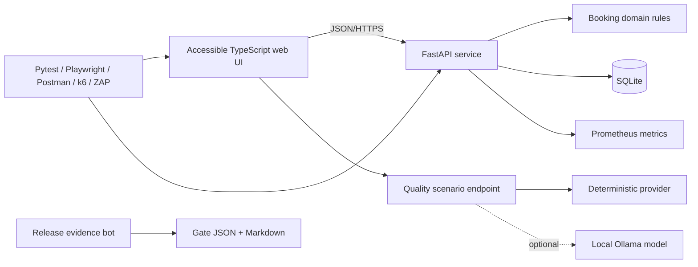

# Architecture

## Context

CivicShift is a public-facing volunteer-event booking service used as a system under test. The repository keeps the product compact so the quality work remains inspectable.

## Components

### Web application

A framework-free TypeScript client renders event availability, submits accessible forms and presents AI-assisted test suggestions. Dynamic text is escaped before template insertion. The checked-in build can be served without a Node runtime; TypeScript source remains rebuildable.

### API

FastAPI exposes typed endpoints, OpenAPI documentation and RFC 7807-style problem responses. Middleware adds request IDs, response timing and security headers. A small in-memory sliding-window limiter protects registration writes in the demo environment.

### Domain/data layer

SQLite transactions use `BEGIN IMMEDIATE` for the capacity boundary. Unique partial indexes prevent active duplicate registrations. Cancellation and wait-list promotion happen in one transaction. Parameterized SQL is used throughout.

### AI-assisted quality endpoint

The default engine is deterministic and maps requirement cues to risk-based scenarios and ISTQB-aligned techniques. The optional Ollama provider treats the requirement as untrusted data, requests JSON, sets low temperature and falls back to the deterministic provider if the local model is unavailable or invalid.

### Quality evidence

Tests and optional tools write independent evidence. The RPA script normalizes that evidence into one release gate. This is deliberately separate from the product API so a broken dashboard cannot approve itself.

## Trust boundaries

1. Browser input to public API.
2. API to local database.
3. Requirement text to optional local model.
4. CI runner to dependency registries and container scanners.
5. Evidence files to the release-gate bot.

The threat model in `automation/security/threat-model.md` covers assets, actors, abuse cases and mitigations.

## Production gaps kept explicit

A production service would normally add managed identity, audited administrative workflows, a durable distributed rate limiter, PostgreSQL, backup/restore automation, centralized observability and a real domain/certificate. Those are documented deployment considerations, not silently implied by the demo.
