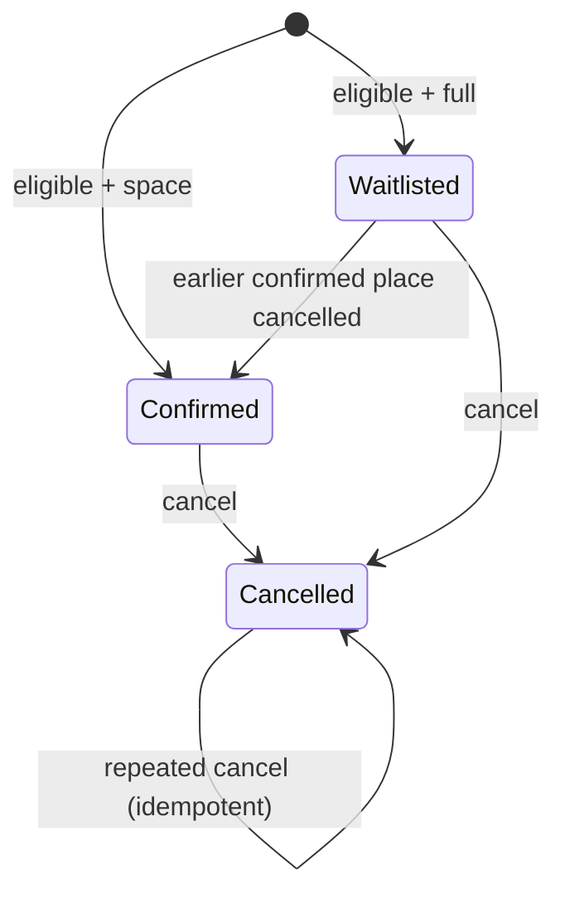

# ISTQB-aligned test analysis and design

This repository applies concepts commonly taught in the ISTQB Foundation syllabus. The purpose is practical use, not memorized definitions.

## Test process activities

1. **Planning:** scope, objectives, approach, resources, environments, entry/exit criteria.
2. **Monitoring and control:** CI results, defect trends, risk changes, flakiness and gate status.
3. **Analysis:** identify testable features and conditions from rules, risks and interfaces.
4. **Design:** choose techniques, data, coverage and expected results.
5. **Implementation:** automate/setup suites, fixtures, order and environment needs.
6. **Execution:** compare actual and expected, retain evidence and investigate anomalies.
7. **Completion:** summarize coverage, unresolved risks, defects and lessons.

## Equivalence partitioning

For attendee age at an event with minimum age 18:

- invalid partition: less than 0 (schema-invalid);
- valid schema but business-invalid: 0–17;
- valid eligible: 18–120;
- invalid partition: greater than 120.

For email: syntactically valid, malformed, missing and case-variant duplicate partitions.

## Boundary value analysis

Capacity `4` uses states at 3, 4 and 5 active requests. Age minimum `18` uses 17, 18 and 19. Input lengths use min−1, min, max and max+1. Rate limit uses limit−1, limit and limit+1.

The key capacity boundary is not only a number. It is a concurrency boundary: two requests may observe one remaining seat. The transaction test and production design review address that risk.

## Decision table

| Published | Eligible | Consent | Space | Result |
|---|---|---|---|---|
| No | any | any | any | 404 / unavailable |
| Yes | No | Yes | any | Reject age rule |
| Yes | Yes | No | any | Reject consent rule |
| Yes | Yes | Yes | Yes | Confirmed |
| Yes | Yes | Yes | No | Wait-listed |

Duplicate and idempotency rules are evaluated before creating a second record: a matching idempotency key replays the original; a new key with the same active event/email is a conflict.

## State transition testing

Registration states:

Invalid transitions include directly creating a cancelled record, promoting a cancelled wait-list record, or returning a cancelled record to active without a new business action.

## Statement/branch coverage

Coverage is useful for identifying unexecuted code, but it is not the objective. Tests focus on decision outcomes, data constraints and risks. The configured threshold prevents obvious erosion while the traceability matrix guards against mistaking line coverage for requirement coverage.

## Experience-based techniques

- **Error guessing:** double-click, reused idempotency key, case-only email change, refresh after submit, stale availability, unusual Unicode and long text.
- **Exploratory testing:** time-boxed charters for capacity, accessibility, resilience and mobile behavior.
- **Checklist-based testing:** security headers, WCAG form controls, SEO metadata and release evidence.

## Confirmation versus regression

A defect fix receives a narrow confirmation test and a wider regression selection based on the affected rule, data constraint and neighboring state transitions. Closing the defect does not mean rerunning only the exact reproduction.

## Shift-left and shift-right

Shift-left evidence includes criteria review, examples, API/schema/static analysis and unit tests. Shift-right evidence includes health, request IDs, metrics, logs, alert/runbook review and production-safe synthetic monitoring design.
