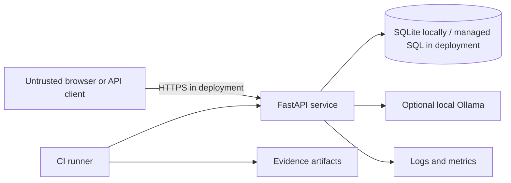

# Security threat model

## Scope and assets

Assets are event capacity, registration state, volunteer name/email, service availability, release evidence and the integrity of AI-assisted test suggestions.

## Trust boundaries

Browser input and optional model output are untrusted. CI artifacts are evidence, not authority by themselves.

## STRIDE-oriented review

| Threat | Example | Control | Test evidence |
|---|---|---|---|
| Spoofing | Caller pretends to be a coordinator | Admin identity is out of scope; no privileged mutation endpoint is exposed | Scope review and route inventory |
| Tampering | Capacity or status changed through crafted input | Server-owned fields, Pydantic validation, DB constraints | mass-assignment and data tests |
| Repudiation | Registration action cannot be traced | Request ID, timestamps, structured logs | header and log-format tests |
| Information disclosure | Email leaks in logs, an idempotency collision exposes another response, or a crafted static path reads repository files | Minimal logs, payload-bound idempotency replay, confined static-file resolution, no public registration list | response, retry-mismatch and path-traversal tests |
| Denial of service | Registration flood or expensive model call | Rate limit, bounded input, local timeout, optional provider fallback | rate-limit and fallback tests |
| Elevation of privilege | Hidden `is_admin` input changes capability | Unknown client field ignored and no admin route | validation test |

## AI-specific threats

- Requirement text tries to override the system instruction.
- Model returns invalid JSON or unsupported priority values.
- Model invents executed test results or release certainty.
- Sensitive context is placed into a third-party provider.

Controls: local deterministic default, explicit untrusted-data delimiters, low temperature, timeout, schema-bounded API response, fallback, adversarial evals and mandatory human review. No secret or internal context is passed by default.

## Deferred production controls

Real authentication/authorization, CSRF strategy for cookie sessions, encrypted managed database, TLS termination, retention/deletion workflows, audit log protection, WAF/rate-limit service and penetration testing require a production context and are not faked here.
