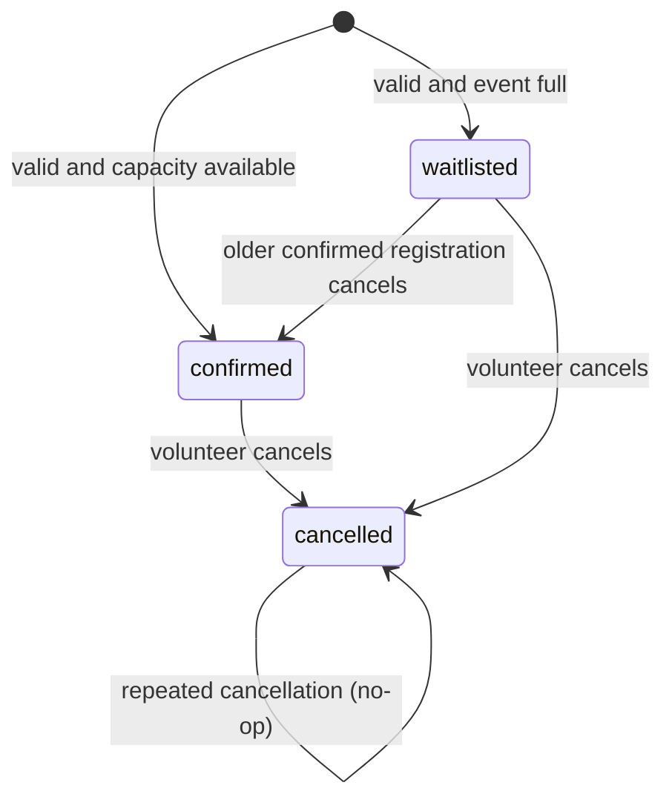

# Registration state transitions

Invalid transitions include direct client selection of status, promotion without a released place, return from cancelled to active using the same record, and promotion that skips an older waiting record.

Tests cover every valid transition and representative invalid paths. A future coordinator override would need authorization, audit and additional transitions rather than directly editing the column.
